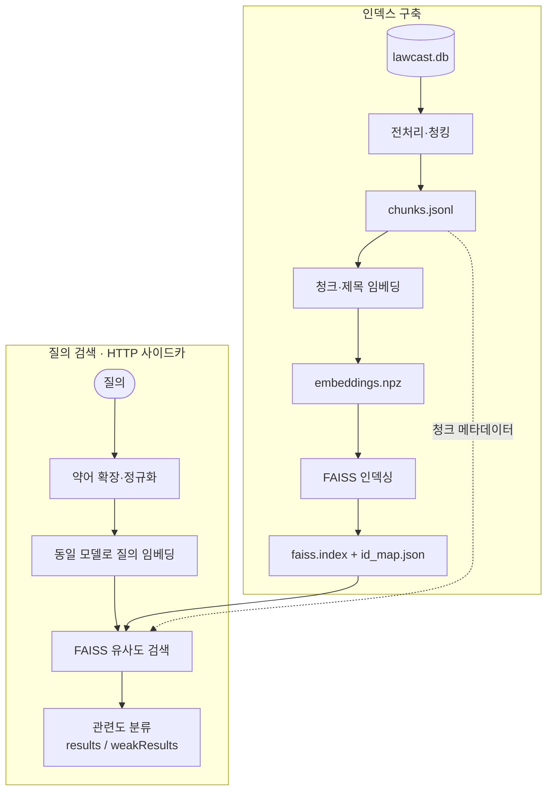

# LawCast Semantic Search

LawCast의 입법예고를 문장의 의미로 찾는 검색 엔진입니다. “세입자 보호”로 “임차인”이 들어간 법률안을 찾는 것처럼, 키워드가 정확히 일치하지 않는 검색을 보완합니다. LawCast 백엔드는 이 엔진을 FastAPI 사이드카로 호출합니다.

검색 대상은 SQLite DB의 `notice_archives.proposalReason`(제안이유 및 주요내용)과 `notice_archive_snapshot_states.ai_summary`입니다. 원문을 섹션과 문장 단위로 나누고 AI 요약은 별도 섹션으로 덧붙입니다. 각 청크를 임베딩할 때 제목을 함께 넣으며 제안이유가 없는 공고는 제목 청크를 유지합니다.

기본 임베딩 모델은 `dragonkue/BGE-m3-ko`이고 L2 정규화한 벡터를 FAISS `IndexFlatIP`로 검색합니다. 질의에도 같은 모델을 쓰며, `중처법` 같은 약어는 사전에 등록된 정식 법안명으로 확장합니다.



## 설치

Python 3.13을 기준으로 합니다. 아래 명령은 별도 안내가 없으면 `semantic-search/`에서 실행합니다.

```bash
cd semantic-search
python3 -m venv .venv
.venv/bin/pip install -r requirements.txt
```

모델 가중치는 처음 실행할 때 Hugging Face에서 내려받습니다. 로컬에서는 CUDA → Apple MPS → Intel XPU → CPU 순으로 사용 가능한 장치를 선택합니다. Docker 이미지는 CPU용 PyTorch를 사용합니다.

## 인덱스 구축과 검색

LawCast DB에서 인덱스를 만들려면 다음 세 단계를 순서대로 실행합니다. DB는 읽기 전용으로 열며, 결과는 `artifacts/`에 저장합니다.

```bash
.venv/bin/python scripts/01_preprocess_chunk.py --db ../backend/lawcast.db
.venv/bin/python scripts/02_extract_embeddings.py
.venv/bin/python scripts/03_build_index.py
```

DB 없이 시험하려면 첫 명령에서 `--db`를 빼면 됩니다. 기본 입력은 저장소의 `data/sample_notices.jsonl`이며, 이 샘플에는 AI 요약이 없습니다.

```bash
.venv/bin/python scripts/04_search.py --query "국가 연구시설과 장비의 공동 활용" --k 3
.venv/bin/python scripts/04_search.py --query "세입자 보호" --query "중처법" --json
```

CLI는 관련도 임계값을 적용하지 않은 상위 청크 순위를 출력합니다. HTTP 서비스의 `results` / `weakResults` 분류와는 다릅니다.

`chunks.jsonl`, `embeddings.npz`, `faiss.index`, `id_map.json`은 함께 관리하는 아티팩트입니다. 서빙 시에는 `chunks.jsonl`, `faiss.index`, `id_map.json`을 읽고 청크 지문, 모델명, 벡터 차원, 인덱스와 ID 매핑의 행 수를 검증합니다. `embeddings.npz`는 임베딩 재사용과 증분 갱신에 사용하며, 서빙 로더는 이 파일을 읽지 않습니다. 개별 파일 교체가 항상 검출되는 것은 아니므로 세트 단위로 관리하세요.

모델을 바꿀 때는 1~3단계를 모두 다시 실행하고 새 모델 설정으로 사이드카를 재시작합니다. 증분 갱신으로 기존 모델의 벡터를 다른 모델의 벡터와 섞을 수는 없으며, `POST /reload`는 모델을 다시 로드하지 않습니다. 임베딩 출력의 `truncated_count`로 입력이 잘렸는지도 확인하세요.

서빙 중인 `artifacts/`에 전체 구축을 바로 실행하지 마세요. 별도 아티팩트 디렉터리에서 구축·검증한 뒤 세트 전체를 교체하고, 교체 중에는 다른 갱신 작업이 실행되지 않게 해야 합니다. 아티팩트 경로는 `LAWCAST_SEMANTIC_ARTIFACTS_DIR`로 지정합니다.

## HTTP 서비스 실행

인덱스를 준비한 뒤 사이드카를 실행합니다.

```bash
.venv/bin/python -m uvicorn service.app:app --host 127.0.0.1 --port 8300
```

다른 터미널에서 상태와 검색 결과를 확인합니다. 한글 질의는 URL 인코딩해서 전달합니다.

```bash
curl http://127.0.0.1:8300/health
curl --get http://127.0.0.1:8300/search \
  --data-urlencode 'query=임대차 계약에서 세입자 보호' \
  --data-urlencode 'k=3'
```

- `GET /health`: `status`가 `loading`, `ready`, `failed` 중 하나로 표시됩니다. `model`, `device`, `indexedChunks`, `maxK`로 현재 엔진 설정을 확인합니다.
- `GET /search`: 기본 질의 길이는 1~500자, `k`는 1~100(기본 5)입니다. **`k`의 단위는 공고가 아니라 청크**이며, 공고별 중복 제거는 백엔드가 담당합니다. 공백만 있는 질의는 400, 길이·범위 위반은 422, 엔진 미준비 상태는 503을 반환합니다.
- 검색 결과는 코사인 유사도에 따라 `results`(기본 0.45 이상)와 `weakResults`(0.25 이상 0.45 미만)로 나뉩니다. 0.25 미만은 제외하며, 관련 결과가 없으면 빈 배열을 반환합니다.
- `POST /reload`: 디스크의 새 아티팩트를 검증한 뒤 메모리의 인덱스를 교체합니다. 성공은 200, 엔진 미준비·갱신 중은 409, 검증 실패는 503입니다. 검증에 실패해도 기존 세대는 계속 서빙합니다. 인증이 없는 내부용 엔드포인트이므로 외부에 공개하지 않습니다.

`/health.lastUpdateAt`은 현재 서빙하는 인덱스의 마지막 기록 시각이며 재시작 후에도 유지됩니다. 시각이 기록되지 않은 구형 아티팩트에서는 `null`입니다. 마지막 자동 갱신 작업의 결과와 오류는 `lastUpdateResult`, `lastUpdateError`로, 진행 여부는 `updating`으로 확인합니다. 수동 재로드 실패는 `reloadError`에 기록됩니다.

시작 시 아티팩트 로딩에 실패하면, DB 경로가 설정되어 있고 추가 임베딩 없이 복구할 수 있는 경우에만 한 차례 복구를 시도합니다. 모델 로딩 실패나 복구 실패로 `failed` 상태가 되면 원인을 해결한 뒤 프로세스를 재시작해야 합니다.

백엔드에서는 `SEMANTIC_SEARCH_ENABLED`, `SEMANTIC_SEARCH_API_URL`, `SEMANTIC_SEARCH_TIMEOUT`을 설정합니다. 기본값은 활성화, `http://127.0.0.1:8300`, `10000`입니다. 타임아웃은 밀리초 단위이며, `SEMANTIC_SEARCH_TIMEOUT`은 개별 요청, `SEMANTIC_SEARCH_TOTAL_TIMEOUT`은 청크 창을 넓혀 조회하는 전체 과정의 예산입니다. 전체 예산의 기본값은 개별 요청 타임아웃과 같습니다. Compose에서는 URL을 `http://semantic-search:8300`으로 지정합니다.

## 설정

[.env.example](.env.example)을 복사해 필요한 값을 설정합니다. 프로세스 환경변수가 `.env`보다 우선합니다. 전체 설정과 기본값은 [lawcast_semantic/config.py](lawcast_semantic/config.py)에서 확인할 수 있습니다.

```bash
cp .env.example .env
```

자주 쓰는 설정은 다음과 같습니다.

- `LAWCAST_SEMANTIC_MODEL`: 임베딩 모델. 기본 `dragonkue/BGE-m3-ko`.
- `LAWCAST_SEMANTIC_DEVICE`: 임베딩 장치. 기본 `auto`; `cpu`, `cuda`, `mps` 등으로 고정할 수 있습니다.
- `LAWCAST_SEMANTIC_BATCH`: 임베딩 배치 크기. 기본 `32`.
- `LAWCAST_SEMANTIC_ARTIFACTS_DIR`: 아티팩트 디렉터리. 기본 `semantic-search/artifacts/`.
- `LAWCAST_SEMANTIC_DB_PATH`: 자동 갱신에 사용할 DB 경로. 기본은 빈 값이며, 이때는 스케줄 갱신과 시작 시 복구가 모두 꺼집니다.
- `LAWCAST_SEMANTIC_UPDATE_CRON`: 갱신 크론 식. 기본 `0 * * * *`이며 프로세스의 로컬 시간대를 따릅니다. 빈 값이면 스케줄 갱신만 끕니다.
- `LAWCAST_SEMANTIC_MIN_SIMILARITY`, `LAWCAST_SEMANTIC_CLEAR_SIMILARITY`: 약한 결과와 명확한 결과의 하한. 기본 `0.25`, `0.45`이며 앞의 값이 뒤의 값보다 클 수 없습니다.
- `LAWCAST_SEMANTIC_MAX_QUERY_LENGTH`, `LAWCAST_SEMANTIC_MAX_K`, `LAWCAST_SEMANTIC_DEFAULT_K`: 질의 길이·청크 창 상한·기본 창 크기. 기본 `500`, `100`, `5`이며 `1 ≤ DEFAULT_K ≤ MAX_K`여야 합니다.

리랭커 등 실험용 설정은 `.env.example`을 참고하세요. 리랭커는 기본 `off`입니다. `shadow` 모드에서는 상위 청크의 점수를 로그에 남기고 `rerankScore`로 응답에도 포함합니다. 사이드카가 순서나 결과 계층을 바꾸지는 않습니다. `/search`에 `rerank=false`를 전달하면 점수 계산을 생략합니다. `lexicalEvidence`도 청크별로 응답하며, 백엔드는 별도 게이트 설정에 따라 이 값과 리랭커 점수를 결과 필터링에 사용할 수 있습니다.

## 인덱스 갱신과 운영

### 자동 갱신

`LAWCAST_SEMANTIC_DB_PATH`를 지정하면 사이드카가 크론 일정에 따라 DB에서 추가·수정되거나 제거된 공고를 반영합니다. 기존 벡터의 임베딩 입력이 같으면 재사용하고, 신규·내용 변경·벡터 누락 청크를 임베딩합니다. 새 인덱스를 검증할 때까지 기존 세대로 검색을 처리합니다. `source_deleted` 상태만으로는 인덱스에서 제외하지 않습니다.

갱신 작업은 `artifacts/.update.lock`을 사용해 중복 실행을 막습니다. 기본 설정에서는 삭제할 공고가 100건을 넘으면서 기존 인덱스 공고 수의 20%도 넘으면 대량 삭제로 보고 갱신을 거부합니다. 실패 원인은 `/health.lastUpdateError`와 서비스 로그에서 확인합니다.

### 수동 갱신

변경 계획만 보려면 다음 명령을 실행합니다. 아티팩트는 변경하지 않습니다.

```bash
.venv/bin/python scripts/06_incremental_update.py --db ../backend/lawcast.db --plan-only
```

실제 갱신을 수행하는 CLI는 잠금을 직접 잡지 않습니다. CLI에는 자동 갱신의 대량 삭제 가드도 적용되지 않으므로 실행 전 `--plan-only` 결과와 DB 경로를 확인하세요. Linux에서는 자동 갱신과 같은 잠금을 사용합니다. 아래 명령은 기본 아티팩트 경로 기준이며, 경로를 바꿨다면 해당 디렉터리의 `.update.lock`을 사용합니다.

```bash
flock artifacts/.update.lock -c \
  '.venv/bin/python scripts/06_incremental_update.py --db ../backend/lawcast.db' && \
curl -X POST http://127.0.0.1:8300/reload
```

macOS에는 `flock` 명령이 기본 제공되지 않으므로 사이드카에서 `LAWCAST_SEMANTIC_UPDATE_CRON`을 빈 값으로 설정해 재시작하고, 진행 중인 갱신이 없는지 확인한 뒤 CLI를 실행합니다. 디스크 갱신 후에는 다음 자동 갱신 시점에 반영되거나, `POST /reload`로 즉시 반영할 수 있습니다.

### Docker 배포

저장소 루트에서 실행합니다. 컨테이너를 처음 올리기 전에 인덱스 세트를 준비해야 합니다.

```bash
docker compose up -d --build semantic-search
curl http://127.0.0.1:8300/health
```

코드는 이미지에, 아티팩트는 호스트의 `semantic-search/artifacts/`에 둡니다. 모델 캐시는 `lawcast_semantic_hf_cache` 볼륨에 보관합니다. Compose는 공유 DB를 `/data/lawcast.db`에 연결하고 `LAWCAST_SEMANTIC_DB_PATH`를 이 경로로 지정하므로, `.env`의 빈 DB 경로와 달리 자동 갱신이 기본 활성화됩니다. 시간대는 `Asia/Seoul`입니다. 호스트 포트 `8300`은 `127.0.0.1`에만 바인딩됩니다.

Compose 헬스체크는 HTTP 응답을 읽지 못하거나 `failed` 상태일 때 실패합니다. 최초 모델 다운로드 중인 `loading`도 헬스체크는 통과하므로 검색 가능 여부는 `/health.status`가 `ready`인지 직접 확인하세요.

### 릴리스 절차

버전은 [pyproject.toml](pyproject.toml)의 `[project].version`에서 관리합니다. 프로덕션 배포는 루트 저장소의 서브모듈 포인터 갱신으로 실행됩니다. 코드와 아티팩트 형식이 함께 바뀌면 새 코드를 먼저 배포하고 인덱스를 갱신합니다.

루트의 `.github/workflows/deploy-semantic-search.yml`은 배포 전 서빙 세트를 기준선으로 저장하고, 배포된 코드가 만들 후보 청크와 비교합니다. 공고별 `indexed`, `title_text`, `section:<라벨>`, `derived:<필드>` 능력이 하나라도 사라지면 배포 검증이 실패합니다. 로컬에서는 다음 순서로 확인합니다.

```bash
.venv/bin/python scripts/07_capability_report.py --db ../backend/lawcast.db \
  --save /tmp/capability-baseline.json
.venv/bin/python scripts/01_preprocess_chunk.py --db ../backend/lawcast.db \
  --out /tmp/candidate-chunks.jsonl
.venv/bin/python scripts/07_capability_report.py --chunks /tmp/candidate-chunks.jsonl \
  --db ../backend/lawcast.db --compare /tmp/capability-baseline.json
```

기준선은 반드시 서빙 중인 아티팩트로 저장합니다. 종료 코드 `0`은 통과, `1`은 능력 손실·아티팩트 불일치 또는 입력 파일·소스 오류, `2`는 잘못된 CLI 인자입니다. 의도적인 손실을 배포하려면 워크플로의 `allow_capability_loss=true` 수동 실행과 사유 기록이 필요합니다.

## 개발과 검증

```bash
.venv/bin/ruff check .
.venv/bin/ruff format --check .
.venv/bin/python -m pytest tests/ -q
```

일반 테스트는 모델 다운로드 없이 실행됩니다. 실제 모델·코퍼스·아티팩트가 필요한 검사는 해당 파일이 없으면 건너뜁니다. 저장소 루트에서는 `python3 tools/check-agent-guidelines.py`도 실행합니다.

검색 품질은 공고 단위 `recall@k`와 `MRR`로 측정합니다. 청크 순위에서 같은 공고의 중복을 제거한 뒤 계산합니다.

```bash
.venv/bin/python scripts/05_evaluate.py --eval data/eval_holdout_queries.jsonl
.venv/bin/python scripts/05_evaluate.py
```

[data/eval_holdout_queries.jsonl](data/eval_holdout_queries.jsonl)은 약어·일상어 질의 평가용이고, [data/eval_queries.jsonl](data/eval_queries.jsonl)은 제목·본문 검색의 회귀 검출용입니다. 비교할 때는 코퍼스를 고정해야 합니다. 코퍼스가 바뀌면 정답 라벨도 다시 확인해야 하며, 작은 평가셋의 점수를 전체 검색 품질로 해석해서는 안 됩니다.

의존성을 변경했다면 테스트를 통과한 뒤 `.venv/bin/pip freeze > requirements.lock`으로 고정본을 갱신합니다. 로컬 설치는 `requirements.txt`, Docker 빌드는 `requirements.lock`을 사용합니다.

## 코드 구조

- `lawcast_semantic/`: 데이터 읽기, 전처리·청킹, 임베딩, 인덱싱, 검색, 증분 갱신 라이브러리.
- `scripts/`: 인덱스 구축·검색·평가 CLI. 각 명령의 옵션은 `--help`로 확인합니다.
- `service/`: FastAPI 사이드카와 자동 갱신 실행기.
- `data/`: 샘플 코퍼스와 평가 질의.
- `tests/`: 단위·통합·회귀 테스트와 공고 픽스처.
- `artifacts/`: 생성된 인덱스 세트. Git으로 관리하지 않습니다.

청킹 규칙은 [chunking.py](lawcast_semantic/chunking.py), 약어 사전은 [aliases.py](lawcast_semantic/aliases.py), 검색 능력 검증은 [capabilities.py](lawcast_semantic/capabilities.py)에서 관리합니다. 약어와 일상 표현을 보완하더라도 비슷한 법안 사이의 순위 경합이나 표현 차이로 검색을 놓칠 수 있습니다.
